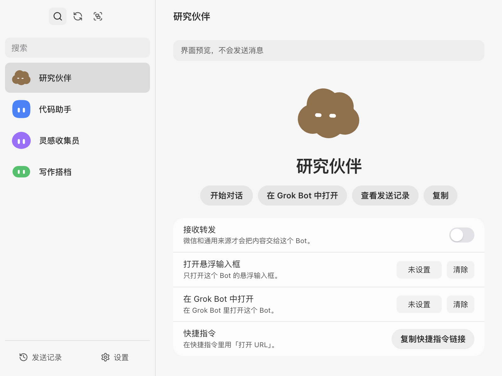
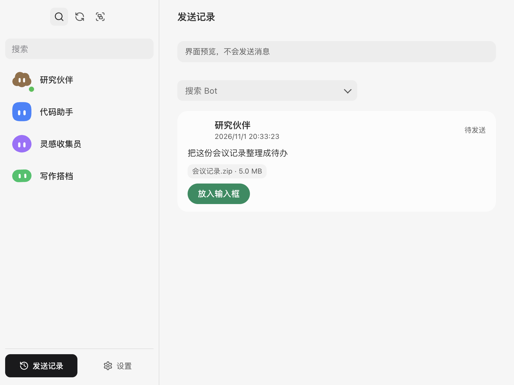
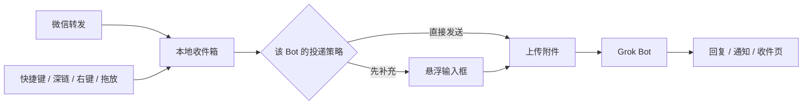

<div align="center">

<h1>Grok Bot Anywhere</h1>

<p><strong>把此刻的上下文，交给自己的 Grok Bot。</strong></p>

<p>微信转发 · Finder / 资源管理器 · 拖放 · 全局悬浮输入框</p>

<p>
<a href="docs/platforms/macos.md"></a>
<a href="docs/platforms/windows.md"></a>
<a href="docs/platforms/linux.md"></a>
<a href="desktop/package.json"></a>
<a href="package.json"></a>

<a href="docs/README.md"></a>
<a href="LICENSE"></a>
</p>

<sub>macOS 已实机验证 · Windows 部分实机验证（开发模式） · Linux 暂不支持</sub>

</div>

<picture>
  <source media="(prefers-color-scheme: dark)" srcset="docs/assets/screenshots/bots-dark.png">
  
</picture>

<p align="center"><sub>预览工作区：Bot 名单、每个 Bot 的接收设置与入口。</sub></p>

> [!IMPORTANT]
> 这是一个**非官方**客户端。它使用你自己的 Grok Bot 账号，与 xAI 没有合作、授权或背书。协议来自对本地客户端的观察，可能随上游更新失效。

## 它解决什么问题

要交给 Bot 的东西常常不在 Bot 窗口里：微信刚转发来的 ZIP、资源管理器里选中的文件、会议结束后的几句话、正在写的半段文字。

Grok Bot Anywhere 把这些上下文接到你指定的 Bot 上，并留下一条本地收件记录：内容有没有落地、有没有发出去、是不是需要你核对。它不是另一个聊天客户端，只做投递入口和收件箱。

## 适合谁

- 已经在用 Grok Bot，希望从任何应用里把内容交给它。
- 有多个 Bot 分工，想让每个 Bot 有自己的入口、投递方式和固定前缀。
- 在意投递结果，不接受「结果不明就自动重发」。
- 使用 macOS，或愿意在 Windows 上帮忙实机验证。

**不适合：** 需要 Linux 桌面支持、需要 Windows 微信「其他应用」里逐 Bot 单列，或只接受官方公开 API 的场景。

## 快速开始

### 从源码运行（macOS）

```sh
git clone --recurse-submodules <repo-url>
cd grok-bot-anywhere
npm run setup
npm run build:native     # Touch Bar、原生输入框、语音
npm run build:share      # 微信转发菜单（可选）
npm run dev
```

首次打开：

1. 连接 Grok Bot 账号。
2. 选择一个 Bot。
3. 在设置里打开「接收转发」，按来源选择微信、系统分享或拖放。
4. 按 `Control+Option+Space` 唤起悬浮输入框。
5. 在微信「转发 → 其他应用」里找到 `发给 {Bot 名}`。

### Windows

```powershell
npm run setup
npm run dev
```

Windows 没有 Swift 伴侣和微信分享宿主；可用 Explorer 右键、拖放、悬浮输入框、URL 协议和 `grok-bot` 命令。完整差异见 [Windows](docs/platforms/windows.md)。

### 安装包

0.1.4 的下载与安装见 [用户操作文档](https://jcng5q8n0f3z.feishu.cn/wiki/HwHmwM4dcidx8Wko50QcJlgGnyd)，也可以从 [GitHub Release](https://github.com/RongleCat/grok-bot-anywhere/releases/tag/v0.1.4) 下载；变更见 [更新说明](docs/updates/0.1.4.md)。也可以从源码构建：

```sh
npm run package:mac    # arm64 + x64 DMG，签名 + 公证
npm run package:win    # 未签名 zip
```

产物在 `desktop/release/`，不进入 git。Windows 包是未签名 zip，尚未在 Windows 实机验证。

## 功能

### 悬浮输入框

全局快捷键在任何应用上唤起（macOS `Control+Option+Space`，Windows `Ctrl+Alt+Space`）；回车发送，Shift+回车换行。输入法组字期间不会误发。Tab 打开 10×2 的 Bot 宫格，支持数字键、方向键、回车和 Esc。

macOS 上还可以用设备端中文语音输入；拖入文件时只登记路径，发送时才复制和上传。发送后输入框收起为带头像、进度条和状态的小条，关闭小条不会中止发送；附件超过 50 MB 会先确认。微信转发会先打开输入框，附件在后台载入。

<p align="center"></p>

### 微信转发菜单（macOS）

macOS：微信「转发 → 其他应用」里，每个启用的接收 Bot 占一行，显示 Bot 名字和头像，点哪一行就投给哪个 Bot。Windows：只有一个 `Grok Bot` 条目，点开后由应用内的 Bot 选择面板决定目标。

macOS 的分享扩展不能在运行时创建，所以预留 12 个签名槽位：第 1–12 个接收 Bot 进入菜单，第 13 个起仍可用悬浮输入框和拖放。

### 收件箱

每条交办都有状态：待补充、已发送、未确认、失败、过期。

- 内容先落到本地，再联网；断网或未登录不丢内容。
- 直接发送在创建后 90 秒内还没开始处理，标为过期，不补发；已经开始上传的不受这个时间限制。
- 发送结果不明确时进入「未确认」并暂停该 Bot，等你去官方客户端核对后再解锁。
- 失败的文件保留在本地，可以重试；不会自动重发。



### 每个 Bot 自己的投递策略

- 收到后**直接发送**，或先放进输入框等你补充。
- 直接发送可加一段固定前缀。
- 微信、系统分享、拖放可以分别开关。
- 关掉某个 Bot 只停止新内容进入，不删除已有记录。

### 头像

Bot 的「更多」菜单里打开头像编辑器：26 个形状 × 11 个颜色全部可选，包含官方编辑器隐藏的南瓜；保存后直接写回账号。

### 命令行、skills 与深链

设置里可以安装 `grok-bot` 命令和随包 skill，让 Agent 用同一账号工作；macOS 上同时把 skill 链接给 Claude Code。

`grokbotanywhere://` 支持 `open`、`compose`、`send` 三种路由。带 `text` 的链接只预填，不自动发送；链接里不放 token。

## 工作原理



- **Electron 主进程**负责窗口、托盘、快捷键、深链和系统集成。
- **独立服务进程**是收件库、上传和发送队列的唯一写入者。
- **Swift 原生伴侣**（仅 macOS）补 Touch Bar、原生输入框、语音、Finder 选区和分享扩展宿主。
- **渲染进程**没有 Node、没有凭据；所有动作走白名单 IPC。

架构与不变量见 [docs/architecture.md](docs/architecture.md)。

## 平台支持

| 平台 | 状态 | 说明 |
| --- | --- | --- |
| macOS 14+ | ✅ 已实机验证 | 登录、名单、悬浮输入框、12 槽微信菜单、收件与发送、签名公证 DMG |
| Windows 10/11 | 🟡 部分实机验证（开发模式） | 启动、主窗口、URL 协议、Explorer 级联、CLI、微信分享入口 + Bot 选择面板已在真机跑过；安装包与右键点击未运行 |
| Linux | ⛔ 未支持 | 没有打包目标与平台适配 |

「已实现」只表示代码和单测存在。Windows 的实机结论按项记录在 [Windows](docs/platforms/windows.md)，没跑过的项不写成已验证。

## 文档

文档按「给 Agent 接手」组织：先读入口，再按任务路由。

| 入口 | 内容 |
| --- | --- |
| [docs/README.md](docs/README.md) | Wiki 首页与任务路由 |
| [docs/architecture.md](docs/architecture.md) | 进程、数据流、仓库分层、不变量 |
| [docs/subsystems/](docs/subsystems/README.md) | 外壳、投递、分享菜单、原生伴侣、SDK、头像、打包 |
| [docs/runbooks/](docs/runbooks/build.md) | 构建、测试、发布、排障 |
| [docs/standards/](docs/standards/code.md) | 代码、测试、文档、提交规范 |
| [docs/decisions/](docs/decisions/0001-electron-over-swift.md) | 架构决策记录 |
| [AGENTS.md](AGENTS.md) | Agent 入口：命令、改哪里、完成定义 |
| [LESSONS.md](LESSONS.md) | 已踩过的坑与对应规则 |
| [llms.txt](llms.txt) | 给外部 LLM 的精简索引 |

## 开发

根 `package.json` 是跨平台命令门面：没有依赖，也没有 workspaces；依赖只装在 `desktop/`。

```sh
npm run setup          # desktop 依赖
npm run dev            # 构建 + 启动
npm run test           # desktop + client-protocol + avatar
npm run test:all       # 再加 Swift
npm run smoke          # 隔离冒烟，使用临时 workspace
npm run docs:check     # 校验 wiki 的 catalog、状态行和链接
```

`make` 目标转发同一组命令。`npm run dev` / `npm run smoke` 会自动剥掉 `ELECTRON_RUN_AS_NODE`，避免 Electron 被当成 Node 启动。

### 项目结构

```text
package.json              根命令门面（private、无依赖）
desktop/                  Electron 主产品
  src/main/               窗口、托盘、快捷键、深链、CLI、分享同步
  src/service/            收件库、上传、发送、账号会话
  src/renderer/           主窗口、悬浮输入框、Tab 宫格
  src/share/              macOS 分享槽位与注册
  src/shell/              跨平台纯函数
native/macos/             Swift 原生伴侣与头像（0.1.0 桥 + Bloub 回退）
packages/client-protocol  非官方协议 SDK / CLI
docs/                     Wiki、平台说明、runbook、规范、ADR
projects/                 本地项目工作区（默认不入库）
legacy/bridge/            早期 SDK 调研，不参与构建
scripts/                  文档校验、跨平台命令启动器、Agent runner
```

## 代码签名

Windows 分发首选 Microsoft Store：个人开发者账号免费，商店认证后重签 MSIX，用户安装没有 SmartScreen 警告，见 [Store 提交](docs/runbooks/store-submission.md)。侧载包通过 [SignPath Foundation](https://signpath.org/) 申请开源签名，或使用商业 OV 证书。macOS 发布包使用 Developer ID 签名并经 Apple 公证。签名状态以对应 release 的校验结果为准。

## 隐私与安全

- 收件库、附件副本和偏好保存在本机 `userData`；应用登录使用 Electron `safeStorage`，没有明文回退。
- 只有主动打开命令行开关时，才会为 `grok-bot` 另外保存一份明文登录；退出登录或关闭开关时删除。
- 微信分享扩展没有网络权限，只把内容写到本地 `ShareInbox`；服务进程校验后才导入。
- 日志和验收报告不记录 token、cookie、聊天正文或私有 Bot ID。
- 测试使用临时目录和注入的 transport，不读写真实账号、Keychain 或用户数据。

安全边界与数据位置见 [docs/reference/configuration.md](docs/reference/configuration.md) 和 [docs/subsystems/delivery-service.md](docs/subsystems/delivery-service.md)。漏洞报告方式见 [SECURITY.md](SECURITY.md)。

## 状态与路线图

当前是 `0.1.0` 预览版，macOS 主路径可用。还没完成的部分：

- [ ] Windows 实机验证（剩余）：安装包首次启动、Explorer 右键点击、悬浮输入框焦点、托盘点击。已跑过的项见 [Windows](docs/platforms/windows.md)。
- [ ] Windows 微信分享入口：MSIX 稀疏包方案仍在验证，未在 Windows 运行。
- [ ] Linux 桌面支持：先决定系统集成最低集，再补打包目标。
- [ ] App Intents、自动更新、公开 Release 页。
- [ ] 更多真实微信版本、Touch Bar 硬件和语音权限的回归。

未完成项不会在功能列表里写成「已支持」。状态细节见 [Windows](docs/platforms/windows.md) 与 [Linux](docs/platforms/linux.md)。

## 参与贡献

欢迎提交 issue 和 PR，尤其是 Windows 实机报告、微信版本差异和可复现的投递问题。

开始之前：

1. 读 [AGENTS.md](AGENTS.md) 和 [CONTRIBUTING.md](CONTRIBUTING.md)。
2. 一个 PR 只做一个目标；行为变化带上能复现的测试。
3. 平台相关的结论写明在哪台机器上跑过；没跑就写「未运行」。
4. 不要提交 token、cookie、真实聊天内容、私有 Bot ID 或签名材料。

## 许可

本项目代码以 [MIT](LICENSE) 许可发布。

第三方组件遵循各自许可：Bloub 头像引擎为 MIT，许可随 `assets/bloub/LICENSE`；`grok-bot-avatar-engine` 为 MIT，许可随 `vendor/grok-bot-avatar-engine-0.1.0.tgz`；Electron、Node 与 `grok-bot-sdk` 遵循其各自仓库的许可。项目内的产品名、Bot 头像和截图仅用于说明。

## 致谢

- [Bloub](https://github.com/jeremy-prt/bloub) — macOS 原生头像渲染引擎（MIT）。
- [grok-bot-avatar-engine](https://github.com/RongleCat/grok-bot-avatar-engine) — Electron 与 Touch Bar 共用的 0.78.1 客户端头像渲染器移植（MIT）。
- [Electron](https://www.electronjs.org/) — 跨平台桌面外壳。
- [grok-bot-sdk](https://github.com/RongleCat/grok-bot-sdk) — Electron 侧的账号、名单、发送与回复订阅。
- [WeChatBridge](https://github.com/freestylefly/WeChatBridge) — macOS 微信分享菜单的公开实现，作为调研参考。
- [ZTools](https://github.com/ZToolsTeam/ZTools) — 视觉与交互参考。

---

<p align="center"><sub>非官方项目，与 xAI 无关联。Grok 及相关名称为其各自权利人的商标。</sub></p>
